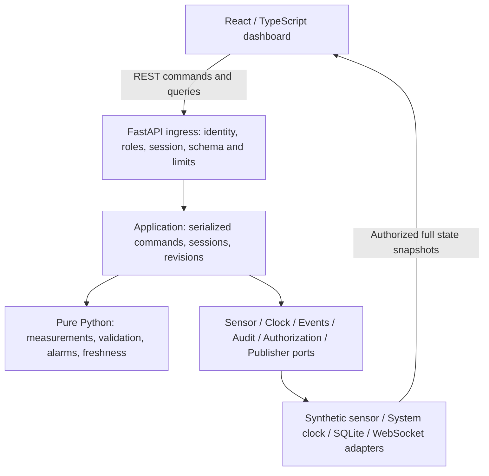

# Architecture decisions for implementation planning

Project Author: Michael Mart
Prepared by Codex, 10 October 2026. Status: PROPOSED / NOT IMPLEMENTED.

This record summarizes the supplied design; it does not create approved design
authority. Existing ADR IDs come from SAD v1.3's controlling addendum. Requirement
and risk mappings below are planning links, subject to traceability approval.

## Architecture and dependency direction

Use the SRS v1.2, SAD v1.3 and SDD v1.1 controlling addenda. Python owns validation,
alarm state, freshness, sessions and events. React/TypeScript renders authoritative
snapshots and sends authorized commands. Domain code imports neither FastAPI nor
SQLite nor frontend types. Application services depend on explicit sensor, clock,
event-store, security-audit, authorization and publication ports; adapters provide
synthetic sensors, system clocks, SQLite and network transport.

The diagram shows conceptual calls and publication, not a bypass of ingress
authorization. No browser-supplied alarm state is accepted as truth. Synthetic
data only; persistent “Simulation only — not for clinical use.” notice on every
monitoring screen. Requirement links: AR-001/002/003, FR-004–016, SF-001–005,
PRIV-001/002; control links: RC-SAF-001–010 as relevant to each component.

## Existing SAD decisions

| Existing ID | Proposed decision and reason | Consequences / required evidence |
| --- | --- | --- |
| ADR-001 | Single-process backend with one in-memory authority and one active session per simulated patient (CD-01). | No multiworker deployment or SQLite-based cross-process coordination. Serialize ticks, acknowledgment, stop and sensor commands. Test concurrent commands and session isolation. FR-016; AR-003; CL-008; RC-SAF-008. |
| ADR-002 | Separate monitoring-event and security-audit sinks with distinct failure semantics (CD-04; CL-005/006). | Monitoring write failure permits domain evaluation and publishes FAILED/INCOMPLETE. Accountable network operator commands require durable audit before mutation. Separate logical contracts; physical DB layout and durable intent/outcome protocol need Q-07/Q-09. SF-005; SEC-005; RC-SAF-005; RC-CYB-003/012. |
| ADR-003 | State revisions and full-snapshot reconnection (CD-03; CL-008). | Accepted mutations increment revision; rejected commands preserve it. Snapshot includes schema/session/revision/server time, latest values/freshness, sensor state, alarm episode/ack, storage health and history completeness. Older revisions discarded; reconnect GET and subscription reconciled without race. SEC-016; RC-SAF-007. |
| ADR-004 | No crash-time restoration of active alarm episodes (CD-02; CL-004). | Start stopped with restart-detected presentation; preserve only readable history; explicit new start resets counters/ack/latest values. Test actual process termination/restart, not only object recreation. FR-016; RC-SAF-007/008. |
| ADR-005 | Network mode only with TLS, roles and session-scoped access (CD-05; CL-007). | Default local mode binds 127.0.0.1 with explicit local operator and visible banner. Network REST/WS enforce authenticated identity, observer/operator authorization, session/origin and credential lifecycle. Authentication details await Q-08. SEC-001/002/003/013; RC-SAF-009; RC-CYB-001/006/008. |

## Behavioral invariants carried into TDD

| Area | Proposed baseline behavior | Primary source links |
| --- | --- | --- |
| Validation | Finite numeric HR 0–300 bpm and SpO₂ 0–100 percent inclusive. Missing, nonnumeric, nonfinite and out-of-range data rejected; last accepted value preserved. Timestamp ordering is strictly increasing measured_at per kind. | FR-003/004/005/015; RC-SAF-003/006 |
| Activation | Three consecutive accepted SpO₂ readings strictly below 92 activate a new episode; 92 is non-low. | FR-006/007; RC-SAF-001 |
| Recovery | Three consecutive accepted SpO₂ readings ≥92 clear an active alarm; a low reading resets recovery. Acknowledgment changes acknowledgment only. | FR-008/009/010; RC-SAF-001/004 |
| Interruptions | Missing scheduled SpO₂, invalid physiological value, missing SpO₂, malformed/missing timestamp reset the applicable pending count. Duplicate/older timestamps, wrong session and unauthorized input preserve counters. Sensor disconnect resets pending activation and preserves active alarm; recovery interruption follows missed/invalid rules. Partial/multiply-invalid input precedence needs Q-04. | FR-007/008/012/015; SF-004; CL-001/002; RC-SAF-001/002/006 |
| Freshness | Per-kind receipt monotonic time; exactly 5.000 seconds current, >5.000 stale; before first valid value no data. UTC timestamps for records, monotonic deadlines for scheduler/freshness. | FR-011; CL-003; RC-SAF-003 |
| Connections | Sensor disconnect and browser transport loss are independent. Preserve accepted values and active alarm; visible transport uncertainty on detection; loss never implies normal physiology. | FR-012; SF-002/003/004; SEC-016; CL-003/008; RC-SAF-002/007 |
| Storage | Monitoring evaluation continues through event-write faults. Next successful write can restore write-health, while history remains incomplete for lost events. Audit availability blocks only accountable network commands; running ticks continue. | SF-005; CL-005/006; RC-SAF-005; RC-CYB-012 |
| Sessions | New explicit session resets measurements, counters, alarm/ack and freshness, while old history remains separately scoped if readable. No implicit crash resumption. | FR-016; CL-004; RC-SAF-008 |

Do not interpret this summary as approved resolution of Q-04/Q-05/Q-07. Tests must
use the complete source requirements and owner clarifications, not this table alone.

## API, persistence and failure boundaries

Plan around the detailed versioned routes: POST `/api/v1/sessions`, POST
`/api/v1/sessions/{id}/stop`, GET `/api/v1/sessions/{id}/state`, GET
`/api/v1/sessions/{id}/events` with bounded pagination, POST
`/api/v1/sessions/{id}/alarms/{episode}/acknowledge`, POST
`/api/v1/sessions/{id}/sensor/disconnect` and `/reconnect`, and WebSocket
`/ws/v1/sessions/{id}/monitor`. Exact wire enums/statuses remain Q-05; auth and
resource limits remain Q-07/Q-08. No raw measurement-injection route is inferred.

Monitoring events have unique IDs, session scope, UTC timestamp, type, details and
deterministic tie-break sequence. Security audit records have separate redacted
actor/action/outcome metadata. Parameterized SQLite operations and file access
controls belong in adapters. Blocking DB calls must not block asynchronous
ingress/monitoring; bounded execution and timeout/backpressure behavior must be
specified. Persisted history is evidence of accepted writes, not a replay log that
restores old alarm state. UTC rollback ordering and audit transaction crash windows
need Q-07 before adapter contracts are finalized.

Trust boundaries: browser↔API, application↔storage, source↔CI↔release, and untrusted
sensor input↔validated domain. Verify auth/roles/session/origin, field limits,
redaction, retention, secrets, supply chain, signed or otherwise approved integrity
mechanism, and rollback at their boundaries. Identity-provider choice, concrete
limits, retention durations and update tooling remain open; none is silently selected.

## Verification and change discipline

Use fake clocks and controlled sensors for deterministic transitions and scheduling;
faulting event/audit repositories and publishers for isolation; temporary SQLite
databases for integration; HTTPX for API integration; Vitest/React Testing Library
for views and Playwright for real browser workflows. Never duplicate alarm logic
in React. All maintained app Python files count toward the ≥90% statement coverage
gate; branch coverage is reported separately without an invented minimum.

Each behavior change requires requirement/risk review, RED test run for expected
missing behavior and meaningful RED commit, minimal GREEN implementation and
regression run, meaningful refactor where needed, verification and RTM evidence
with revision/CI/reviewer. Process/tooling choices and exact versions are Phase 1
work, requiring approval first. Changes to this proposed architecture require
impact review across SRS/SAD/SDD/STP/RTM/SHA/CRA and explicit owner approval.
